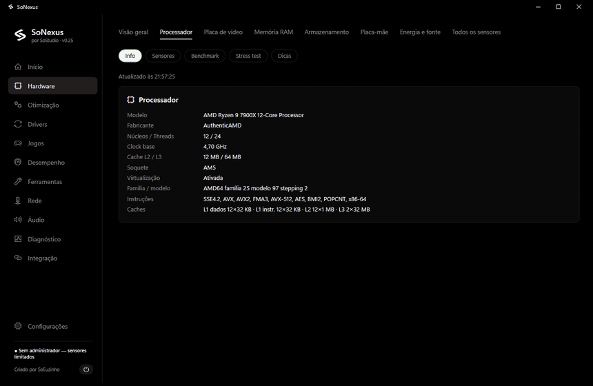
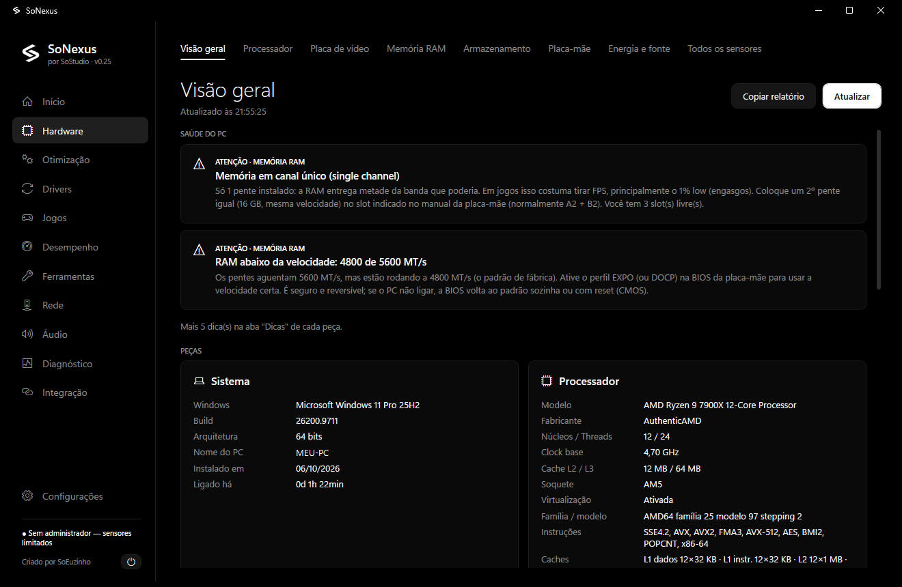
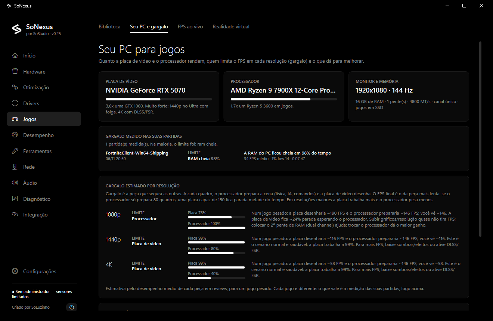
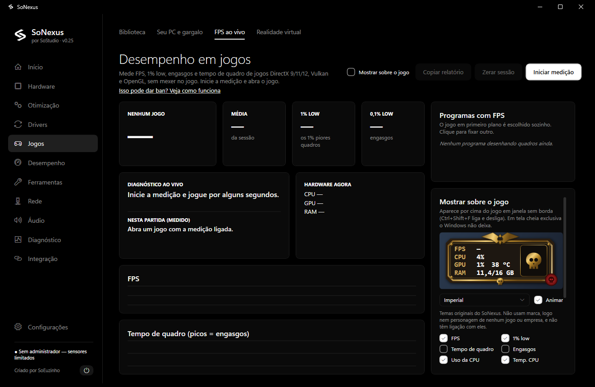
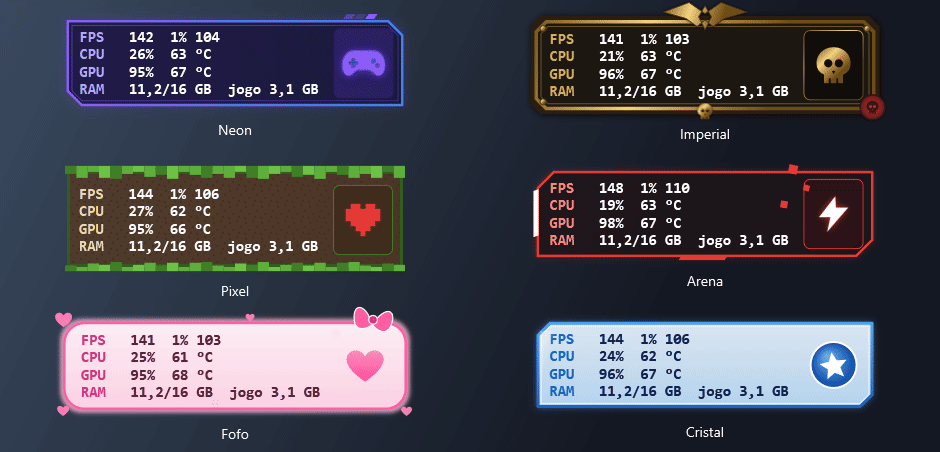
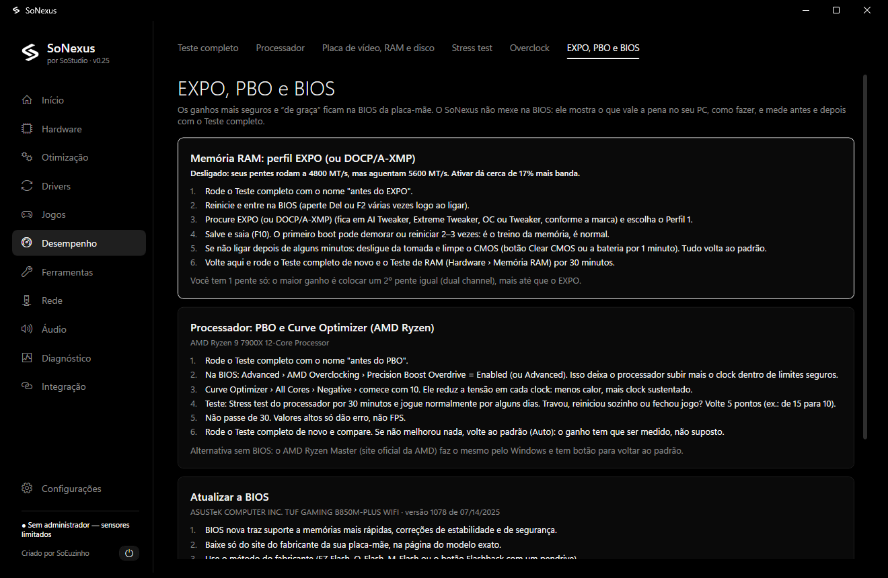
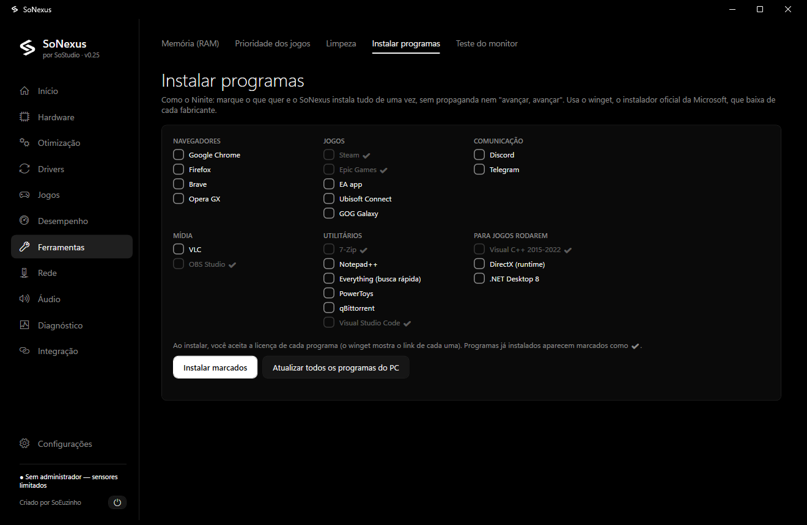
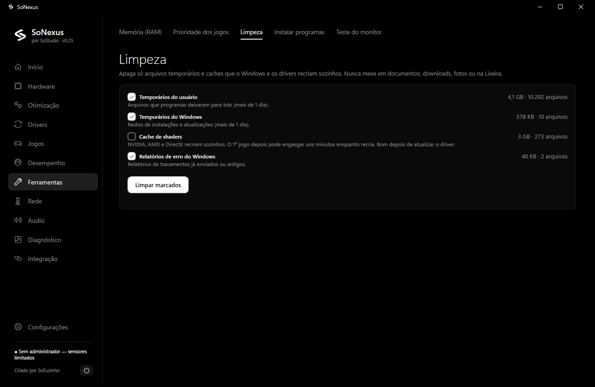
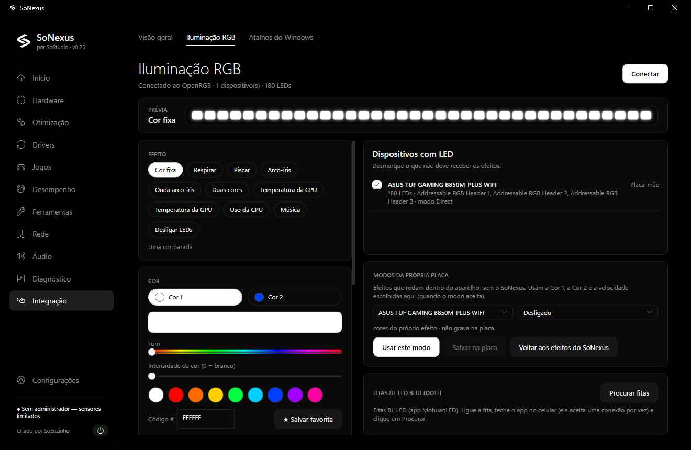
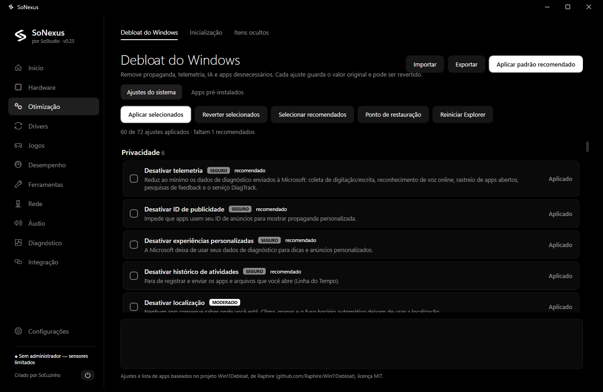

<div align="center">

# SoNexus

**O seu PC inteiro num app só.**
Hardware, jogos, desempenho, otimização e iluminação para Windows — grátis e de código aberto.

por **SoStudio** · criado por **SoEuzinho**

[**⬇ Baixar a última versão**](https://github.com/SoEuzinho/SoNexus/releases/latest) ·
[🎬 Vídeo de divulgação](docs/media/divulgacao.mp4) ·
[▶ Demonstração completa](docs/media/demo.mp4)



</div>

---

## O que ele faz

Em vez de ter CPU-Z, HWMonitor, MSI Afterburner, Process Lasso, RAMMap, Ninite e um monte de scripts, o SoNexus junta tudo numa interface só, em português, com explicação simples do que cada número significa e do que fazer.

| | |
|---|---|
| **Hardware por peça** | Processador, placa de vídeo, RAM, discos, placa-mãe e fonte, cada um com informações, sensores (com mínimo e máximo), testes e dicas. |
| **Saúde do PC** | Acha sozinho o que está segurando o computador: RAM em canal único, EXPO/XMP desligado, disco cheio, BIOS antiga, monitor abaixo do Hz. |
| **Jogos** | Biblioteca de todos os launchers, FPS ao vivo, 1% low, engasgos e **gargalo medido de verdade durante a partida**. |
| **Painel sobre o jogo** | Overlay com temas animados, configurável e leve (menos de 0,25% de CPU). |
| **Desempenho** | Teste completo (CPU, GPU, VRAM, RAM e disco, 3 rodadas), comparação antes/depois, stress test com corte por temperatura, overclock da placa e guia de EXPO, PBO e BIOS. |
| **Ferramentas** | Liberar memória em espera, prioridade automática para jogos, limpeza de temporários, instalar vários programas de uma vez e teste de monitor (Hz e rastro). |
| **Otimização** | Mais de 70 ajustes do Windows (telemetria, anúncios, IA, jogos), todos com backup e botão de desfazer. |
| **Drivers, rede e áudio** | Driver de vídeo com um clique, remoção limpa (estilo DDU), rotas até servidores de jogos, DNS, Voicemeeter. |
| **Iluminação** | RGB pelo OpenRGB e fitas de LED Bluetooth (BJ_LED), com efeitos que seguem a temperatura, o uso ou a música. |

## Telas

### Saúde do PC e hardware por peça


### Gargalo e FPS ao vivo



### Temas do painel sobre o jogo


<sub>Temas originais do SoNexus (valores ilustrativos na animação). Nenhum usa marca, logo ou personagem de jogo ou empresa.</sub>

### Desempenho: EXPO, PBO e BIOS


### Ferramentas



### Iluminação RGB e otimização do Windows



## Vídeos

- 🎬 **[Vídeo de divulgação (40 s)](docs/media/divulgacao.mp4)**: o SoNexus em 40 segundos, para compartilhar.
- ▶ **[Demonstração completa (47 s)](docs/media/demo.mp4)**: passando pelas telas do app.

## Instalar

1. Baixe o `SoNexus-Setup-<versão>.exe` na página **[Releases](https://github.com/SoEuzinho/SoNexus/releases/latest)**.
2. (Opcional) confira o arquivo com o SHA-256 publicado ao lado:
   ```powershell
   Get-FileHash .\SoNexus-Setup-0.25.0.exe -Algorithm SHA256
   ```
3. Instale e abra. Na primeira vez, o SoNexus mostra os Termos de Uso e Privacidade.

Requisitos: Windows 10 (1809+) ou 11, 64 bits. Não precisa instalar o .NET. O app pede administrador (sensores, ventoinhas e ajustes do sistema).

Para a temperatura do processador, o SoNexus oferece instalar o driver **PawnIO** (assinado), que substitui o antigo WinRing0 bloqueado pelo Windows Defender.

## Segurança e privacidade

- **Nada sai do seu PC**: sem conta, sem propaganda, sem rastreamento. Consultas na internet (requisitos de jogos, drivers) podem ser desligadas.
- **Tudo tem desfazer**: cada ajuste do Windows guarda o valor original.
- **Jogos e anti-cheat**: o FPS é medido pelos eventos públicos do Windows (ETW, o mesmo método do PresentMon) e o painel é uma janela separada. O SoNexus não lê nem altera a memória dos jogos. Mesmo assim, cada anti-cheat tem regras próprias: em jogos competitivos, se tiver dúvida, desligue o painel.
- **Overclock com travas**: tensão bloqueada, limites de temperatura e regras de segurança antes de liberar os controles.

## Compilar

```powershell
winget install Microsoft.DotNet.SDK.8
winget install JRSoftware.InnoSetup
.\build.ps1
```

Gera `publish\<versão>\` (versão portátil) e `installer\Output\SoNexus-Setup-<versão>.exe` + `.sha256`.

Feito em C# / WPF (.NET 8) com LibreHardwareMonitor, TraceEvent (ETW), NAudio, Vortice (Direct3D 11) e OpenRGB SDK.

## Licença e créditos

Código sob a licença [MIT](LICENSE) — © 2026 SoEuzinho (SoStudio).
Bibliotecas e projetos de terceiros: veja [THIRD-PARTY-NOTICES.txt](SoNexus/THIRD-PARTY-NOTICES.txt).
Marcas citadas (NVIDIA, AMD, Intel, Microsoft, Steam etc.) pertencem aos seus donos; o SoNexus não é afiliado a elas.
