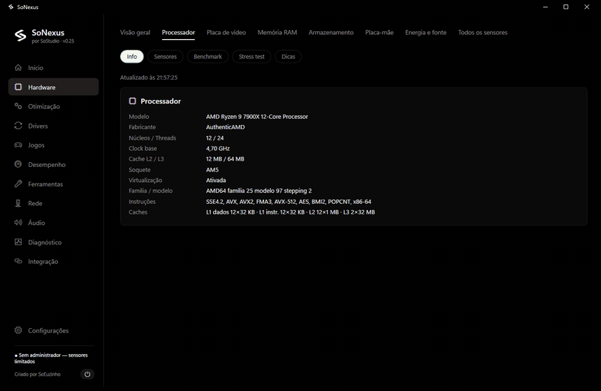
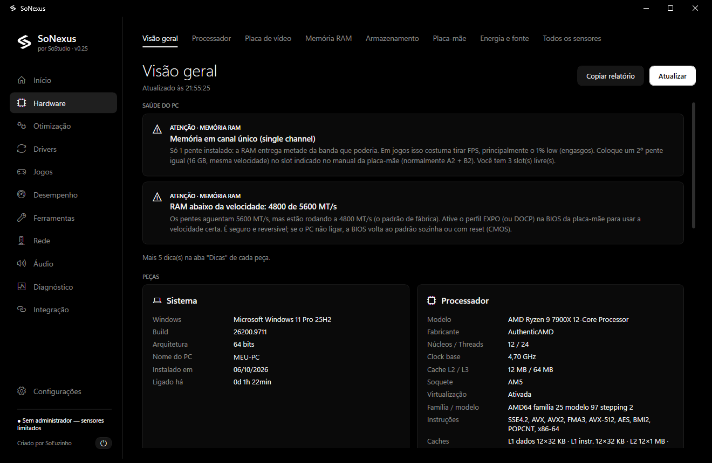
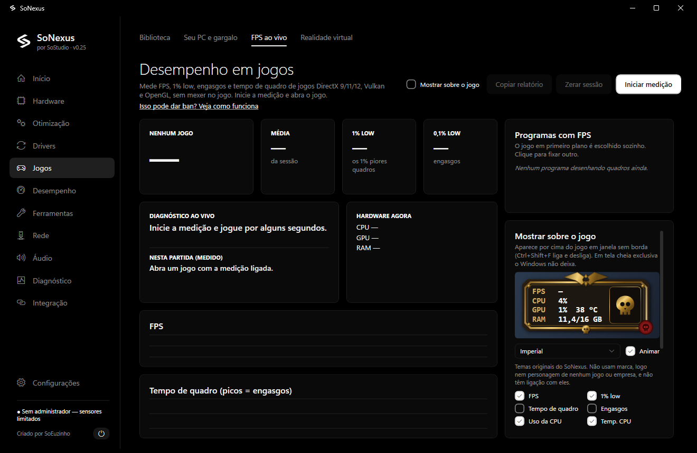
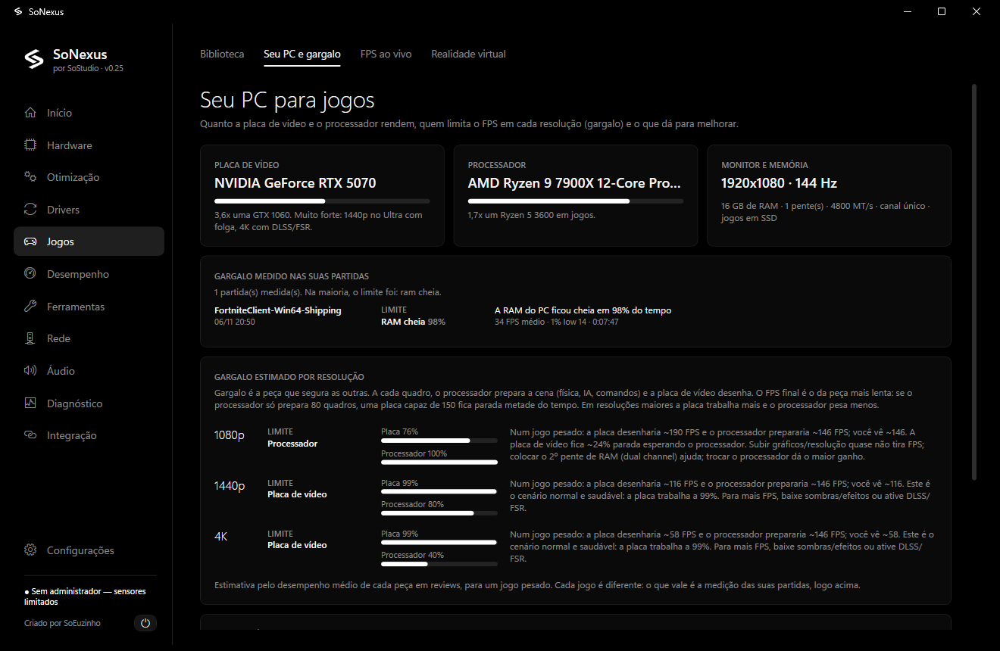
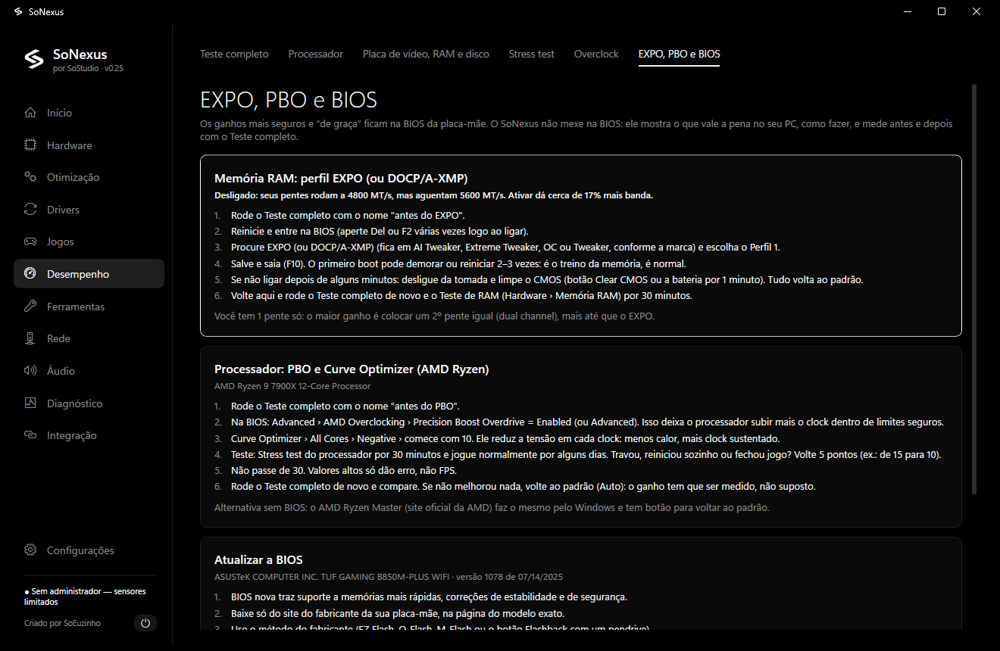
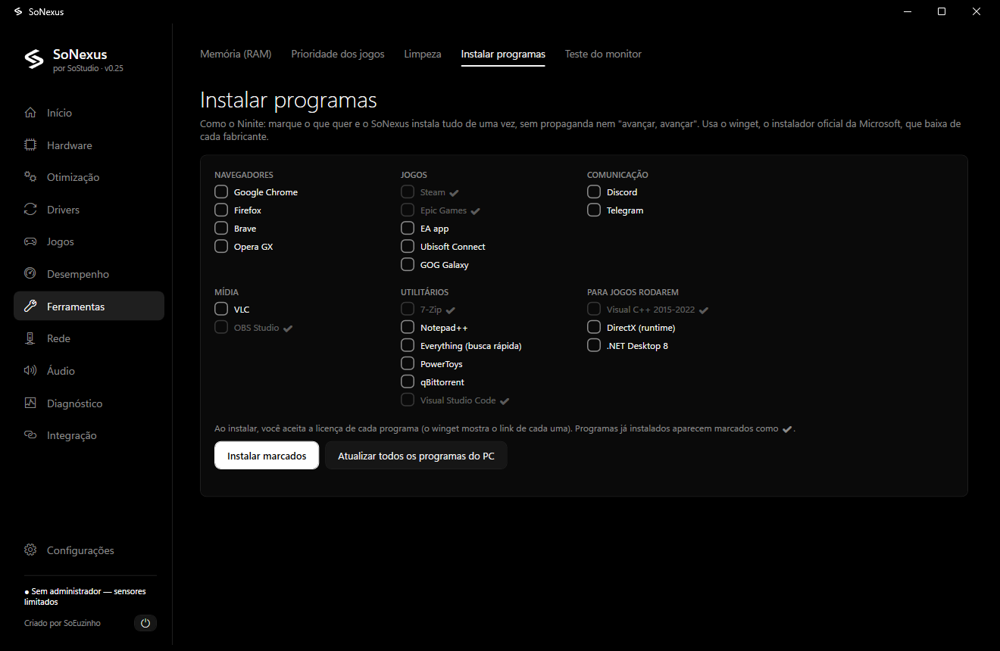
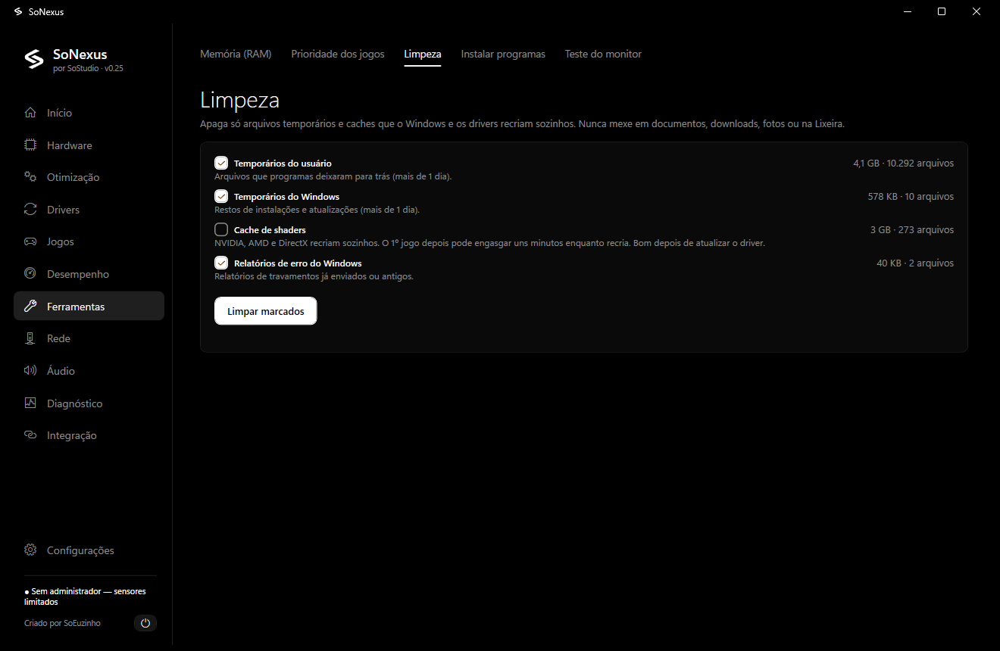
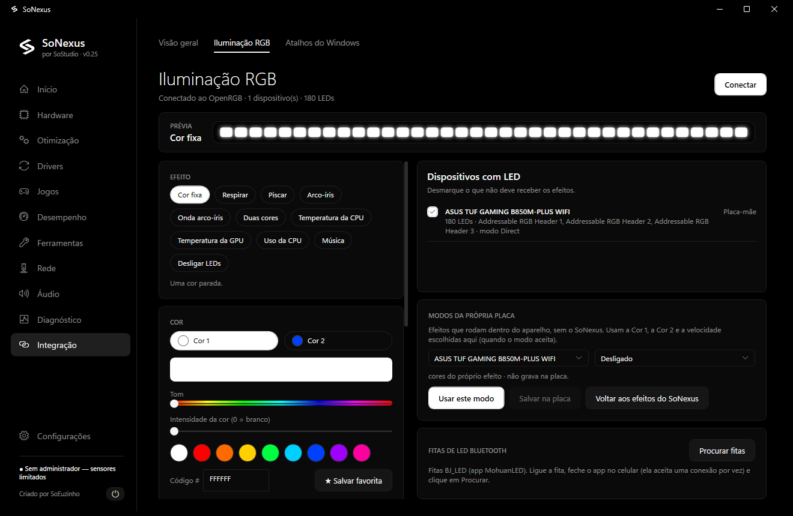
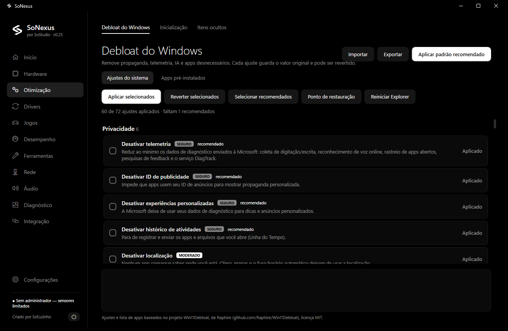
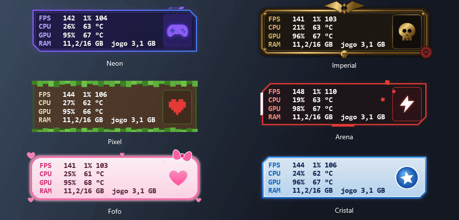

<div align="center">


# SoNexus

**Monitoramento, jogos e ferramentas para Windows**

Veja como seu PC está funcionando, compare o desempenho das suas partidas e gerencie drivers, ajustes do Windows e iluminação em um app gratuito, de código aberto e em português.

[](https://github.com/SoEuzinho/SoNexus/releases/latest)

[](LICENSE)


[Funcionalidades](#funcionalidades) · [Instalação](#instalação) · [Demonstração](#demonstração) · [Privacidade](#privacidade) · [Compilar](#compilar)

Criado por **SoEuzinho** · **SoStudio**

</div>

---

## Funcionalidades

| Área | O que você pode fazer |
|---|---|
| **Hardware** | Acompanhar temperaturas, uso, clocks, consumo e ventoinhas. Consultar a saúde dos discos e o histórico SMART quando o hardware disponibiliza esses dados. |
| **Jogos** | Encontrar instalações de launchers compatíveis, acompanhar FPS e 1% low e comparar duas partidas. Salvar posição, tamanho e métricas do overlay por executável. |
| **Desempenho** | Executar benchmarks de CPU, GPU, memória e disco, comparar resultados e usar testes de carga com proteção térmica. Consultar guias de BIOS, EXPO e PBO. |
| **Drivers** | Consultar versões instaladas, buscar drivers de vídeo e remover pacotes selecionados. Exportar um backup antes da remoção e escolher um INF salvo para reinstalar. |
| **Diagnóstico** | Consultar falhas e telas azuis registradas pelo Windows, investigar latência DPC e gerar um relatório de suporte local com prévia. |
| **Otimização** | Gerenciar inicialização, modificar ajustes do Windows com opções de reversão, limpar temporários, testar o monitor e instalar programas via WinGet. |
| **Rede e áudio** | Acompanhar tráfego por aplicativo, testar rotas e DNS, ajustar volumes e integrar o Voicemeeter. |
| **Iluminação** | Controlar dispositivos compatíveis pelo OpenRGB ou fitas Bluetooth BJ_LED, com efeitos que reagem à música, à temperatura ou ao uso do PC. |

**Como interpretar os dados de jogos.** O FPS ao vivo é calculado a partir das apresentações registradas pelo Windows via ETW. Os sinais de gargalo são inferidos a partir da telemetria do sistema durante a partida. As previsões da biblioteca e da tela por resolução usam requisitos e tabelas de referência.

## Instalação

1. Abra a [última versão publicada](https://github.com/SoEuzinho/SoNexus/releases/latest) e baixe o arquivo `SoNexus-Setup-<versão>.exe`.
2. Se quiser conferir o download, compare o SHA-256 com o arquivo publicado junto ao instalador.

   ```powershell
   Get-FileHash ".\SoNexus-Setup-<versão>.exe" -Algorithm SHA256
   ```

3. Execute o instalador e abra o SoNexus. Na primeira abertura, leia os Termos de Uso e Privacidade.

O SoNexus requer **Windows 10 (1809 ou posterior) ou Windows 11, x64**. O instalador inclui o runtime do .NET. O aplicativo solicita autorização de administrador pelo Windows para acessar sensores e recursos do sistema. Alguns sensores de CPU e placa-mãe podem exigir o driver assinado **PawnIO**, oferecido pelo próprio app.

### Por onde começar

| Quero… | Onde abrir |
|---|---|
| **Ver a saúde do PC** | Abra **Hardware** e escolha uma peça. Em **Armazenamento**, consulte as leituras SMART disponíveis. |
| **Medir um jogo** | Abra **Jogos › FPS ao vivo**, inicie a medição e jogue por pelo menos 30 segundos. Consulte as sessões em **Seu PC e gargalo**. |
| **Preparar uma instalação limpa do driver** | Abra **Drivers › Remover driver de vídeo**, confira os pacotes marcados e escolha onde guardar o backup. |
| **Investigar travamentos** | Abra **Diagnóstico › Erros e telas azuis**. Na aba **Relatório de suporte**, revise a prévia antes de salvar. |

## Demonstração



[Vídeo de divulgação (1min15)](docs/media/divulgacao.mp4) · [Demonstração completa (47 s)](docs/media/demo.mp4)

<details>
<summary>Ver capturas de tela e temas do overlay</summary>

| Hardware | FPS ao vivo |
|---|---|
|  |  |

| Gargalo e estimativas | EXPO, PBO e BIOS |
|---|---|
|  |  |

| Instalação de programas | Limpeza |
|---|---|
|  |  |

| Iluminação RGB | Otimização do Windows |
|---|---|
|  |  |



Os números na animação dos temas são ilustrativos.

</details>

## Privacidade

O SoNexus funciona sem cadastro ou rastreamento. Configurações, logs e backups ficam no PC. Funções online podem consultar serviços de terceiros, como a loja Steam para requisitos de jogos. Você pode desligar as consultas automáticas em **Configurações › Privacidade**. [Termos de Uso e Privacidade](SoNexus/TERMOS-E-PRIVACIDADE.txt)

O overlay é uma janela separada que usa eventos do Windows para acompanhar a apresentação de quadros. Cada jogo pode ter regras próprias para overlays e anti-cheat.

## Compilar

O app usa **C# com WPF no .NET 8**. Entre as dependências estão LibreHardwareMonitor para sensores, TraceEvent para ETW, NAudio para áudio e Vortice para Direct3D 11.

Para compilar a partir da raiz do repositório:

```powershell
winget install Microsoft.DotNet.SDK.8
dotnet build .\SoNexus\SoNexus.csproj -c Release
```

Para gerar a distribuição portátil, o instalador e o arquivo SHA-256:

```powershell
winget install JRSoftware.InnoSetup
.\build.ps1
```

A versão portátil fica em `publish\<versão>\`. O instalador e o SHA-256 ficam em `installer\Output\`.

## Licença e créditos

SoNexus é um projeto de **SoEuzinho (SoStudio)** distribuído sob a [licença MIT](LICENSE). As licenças das dependências estão em [THIRD-PARTY-NOTICES.txt](SoNexus/THIRD-PARTY-NOTICES.txt).
